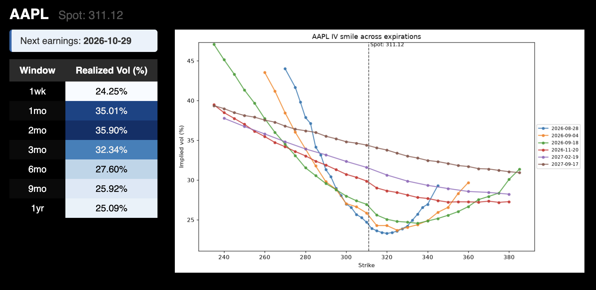

# volatility-analysis

Takes a ticker inputted by the user, pulls live options chains and price history from Yahoo
Finance, and produces an implied volatility curve at up to six expirations plotted against
strike price, and a table of realized volatility over seven lookback windows.

## Why it's useful

The tool gives the user an easy way to look at what volatility is being priced at, how skew
is shaped across expirations, and how implied vols compare to past movement.

## Getting started

The tool requires `yfinance`, `pandas`, `numpy`, and `matplotlib`. To use it, set the ticker
variable near the top and run all cells.

---

Built and maintained by [Gus McKinney](https://linkedin.com/in/gus-mckinney).
